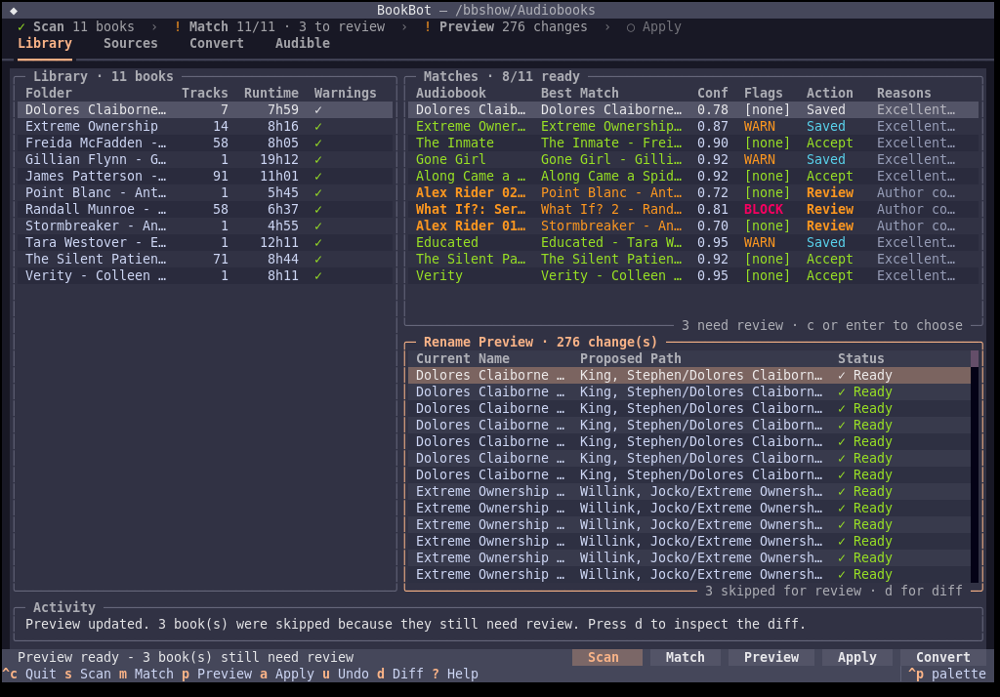
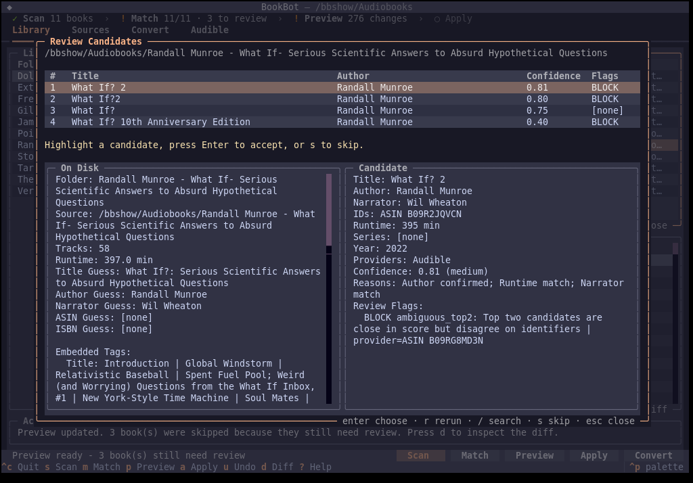
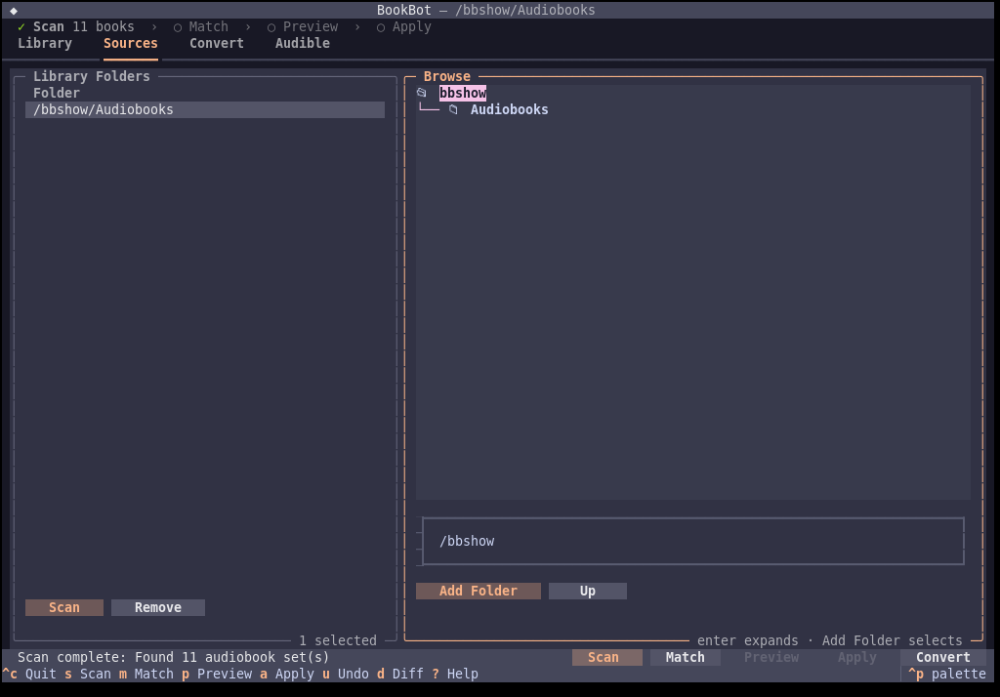
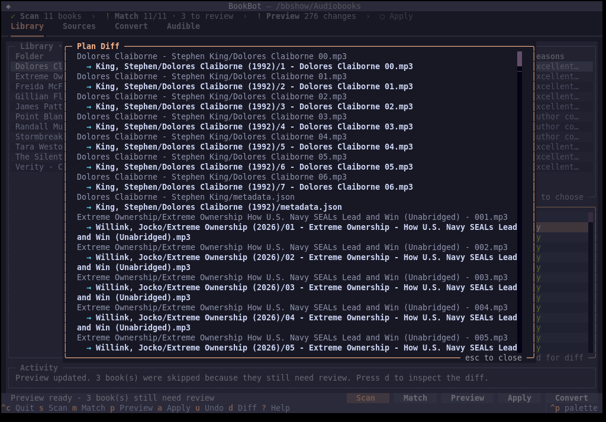
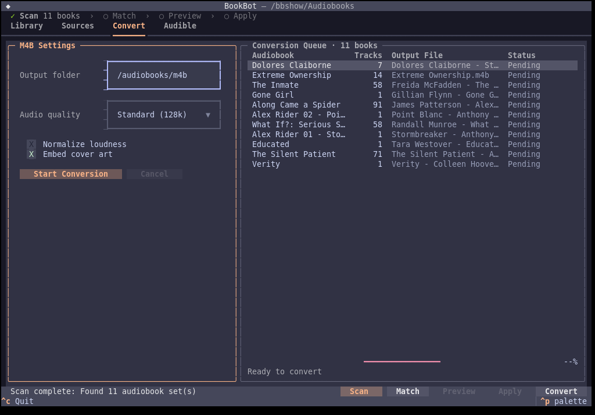

<p align="center">
  
</p>

<h1 align="center">BookBot</h1>

<p align="center"><em>A terminal command center for audiobook collectors who care about clean metadata.</em></p>

<p align="center">
  <a href="https://github.com/itsbryanman/BookBot/actions/workflows/ci.yml"></a>
  <a href="https://pypi.org/project/bookbot-cli/"></a>
  <a href="https://pypi.org/project/bookbot-cli/"></a>
  <a href="https://github.com/itsbryanman/BookBot/pkgs/container/bookbot"></a>
  <a href="LICENSE"></a>
</p>

BookBot scans a messy audiobook library, matches every book against several metadata providers, and shows you the exact renames before anything moves. Changes are applied atomically, journaled for crash recovery, and can be undone with one key.

## Screenshots

<p align="center">
  
</p>

<table>
  <tr>
    <td align="center" width="50%"><br /><sub>Compare candidates against what is on disk</sub></td>
    <td align="center" width="50%"><br /><sub>Pick library folders without leaving the app</sub></td>
  </tr>
  <tr>
    <td align="center"><br /><sub>Full plan diff before you apply</sub></td>
    <td align="center"><br /><sub>Queue single-file M4B conversions</sub></td>
  </tr>
</table>

## Highlights

- **Reviewable plans.** Scan, preview, diff, apply atomically, undo. Interrupted applies are rolled back from a write-ahead journal with `bookbot recover`.
- **Multi-provider matching.** Audnexus, Audible, Open Library, and LibriVox are queried together (plus Google Books and Hardcover with a key). Embedded ASIN/ISBN lookups come first, providers corroborate each other, and runtime checks flag abridged or wrong editions. `bookbot match` explains every score.
- **Collector profiles** for Audiobookshelf, Plex, Prologue, and Apple Books, with configurable folder and file templates.
- **Library audits.** `doctor` checks your setup and a library before changes land; `health` finds missing covers, tag drift, duplicates, and series gaps.
- **Duplicate quarantine.** `dedupe` moves byte-identical files and duplicate editions into a quarantine folder. Nothing is deleted, and it is undoable.
- **M4B tooling.** Convert, merge, split, tag, and detect chapters with FFmpeg.
- **Sidecars and integrations.** Read OPF, Audiobookshelf JSON, and NFO; sync progress with an Audiobookshelf server; Audible library and AAX tools for books you own.

## Install

BookBot needs Python 3.10+ and a system `ffmpeg`.

```bash
pipx install bookbot-cli        # the command is `bookbot`
```

**Docker** bundles FFmpeg and every Python dependency:

```bash
docker run -it --rm \
  -v "/path/to/audiobooks:/data" \
  -v "$PWD/config:/config" \
  ghcr.io/itsbryanman/bookbot:latest tui /data
```

With the included [`docker-compose.yml`](docker-compose.yml), put your library in `./audiobooks` and run `docker compose run --rm bookbot`. The Audible browser login needs a display, so run `bookbot audible auth` on the host.

**From source:**

```bash
git clone https://github.com/itsbryanman/BookBot.git
cd BookBot
python -m pip install -e ".[dev]"
```

## Quick start

```bash
bookbot tui /path/to/audiobooks              # interactive: scan, match, preview, apply
```

Or script the same flow:

```bash
bookbot doctor /path/to/audiobooks           # check FFmpeg, config, and the library
bookbot scan /path/to/audiobooks --plan plan.json
bookbot plan diff plan.json                  # exact moves, nothing touched yet
bookbot apply plan.json                      # prints a transaction ID
bookbot undo <transaction-id>                # a unique prefix is enough
```

## The TUI

`bookbot tui DIR...` opens the library view: books on the left, matches and the rename preview on the right, and a progress strip across the top (`Scan › Match › Preview › Apply`). Launch it without a folder and pick one on the **Sources** tab. Matching runs in the background, so the interface stays responsive on large libraries.

| Key | Action |
| --- | --- |
| `s` | Scan the library folders |
| `m` | Match every book against the metadata providers |
| `Enter` / `c` | Compare candidates for the highlighted match |
| `A` | Accept every safe match (no blocking flag, confidence 0.75+) |
| `p` | Preview the rename plan |
| `a`, `a` | Apply (press twice; switching tabs or waiting 10 s cancels) |
| `u` | Undo the latest applied transaction |
| `d` | Full plan diff |
| `f` | List scan warnings |
| `ctrl+r` | Rescan from disk |
| `?` | All shortcuts |

In the candidate picker: `Enter` accepts, `r` re-runs matching, `/` searches by title, author, ASIN, or ISBN, `s` skips the book, and `Esc` closes. Add `--metadata-from-files` to work offline from existing sidecars.

## Command reference

Run `bookbot COMMAND --help` for every option. Global flags: `--config-dir PATH`, `--version`.

**Plans and history**

| Command | Purpose |
| --- | --- |
| `scan DIR --plan PLAN.json` | Find audiobooks, infer series and disc layout, and write a plan. |
| `plan create\|show\|diff\|validate\|apply` | The plan workflow, step by step. |
| `review PLAN.json` | Show a plan with warnings and conflicts. |
| `apply PLAN.json [--yes]` | Apply atomically and print a transaction ID. |
| `history` / `undo ID` / `recover [ID]` | List, roll back, or recover interrupted transactions. |

**Matching and review**

| Command | Purpose |
| --- | --- |
| `match DIR [--show-all] [--json]` | Show merged candidates and why they scored as they did. |
| `review-queue DIR` | List books that still need a decision. |
| `accept DIR --set N --candidate M` | Accept a candidate (or `--skip` the book). |
| `provider list\|enable\|disable\|set-key\|set-marketplace` | Configure metadata providers. |

**Library tools**

| Command | Purpose |
| --- | --- |
| `doctor [DIR]` | Check the runtime and audit a library for compatibility problems. |
| `health DIR [--json-output]` | Missing covers, inconsistent tags, orphans, duplicates, series gaps. |
| `dedupe DIR [--apply]` | Quarantine duplicate files and editions; undo with `bookbot undo`. |
| `organize DIR --template abs\|plex\|default [--confirm]` | Restructure into a player layout. Not journaled; use `scan` + `apply` when you want undo. |
| `profile list\|show\|use NAME` | Built-in collector profiles. |
| `config show\|get\|set\|edit\|where\|reset` | Settings, e.g. `config set output.folder_template "{author_sort}/{title}"`. |

**Audio, chapters, and sidecars**

| Command | Purpose |
| --- | --- |
| `convert DIR -o OUT [--normalize] [--chapters auto]` | Build a single chaptered, tagged M4B. `--dry-run` prints the plan. |
| `m4b merge\|split\|tag\|chapters` | Work with existing M4B files. |
| `chapters detect\|apply DIR` | Chapters from Audnexus, cue files, track boundaries, or silence. |
| `sidecar read\|write\|sync DIR` | OPF, JSON, and NFO metadata files. |

**Integrations**

| Command | Purpose |
| --- | --- |
| `abs login\|libraries\|list\|search\|show\|match\|progress\|sync` | Audiobookshelf server tools. `abs sync --watch` keeps progress in sync. |
| `audible auth\|list\|import` | Log in, list your Audible library, import by list number. |
| `drm detect\|set-activation-bytes\|remove` | AAX tools for books you own. |
| `completions bash\|zsh\|fish` | Shell completions. |

## Configuration

`bookbot config where` prints the active paths. The config directory comes from `--config-dir`, then `BOOKBOT_CONFIG_DIR`, then `~/.config/bookbot` (`%APPDATA%\bookbot` on Windows). When you set it explicitly, the cache and logs live under it too.

| Path | Contents |
| --- | --- |
| `config.toml` | Main settings (TOML). |
| `profiles/*.toml` | `safe`, `audiobookshelf`, `plex`, `prologue`, `apple-books`, `full`, `conversion`. |
| `author_aliases.json` | Optional pen-name and spelling aliases used during matching. |
| `~/.cache/bookbot/bookbot_cache.db` | Provider lookup cache; delete it to force fresh lookups. |
| `~/.local/share/bookbot/logs/` | Transaction journals for undo and recover, plus logs. |

**Templates.** The defaults are `output.folder_template = "{author_sort}/{title} ({year})"` and `output.file_template = "{DiscPad}{TrackPad} - {TrackTitle}"`. Available tokens: `{author}`, `{authors}`, `{author_sort}`, `{title}`, `{short_title}`, `{series}`, `{series_index}`, `{year}`, `{narrator}`, `{language}`, `{isbn}`, `{disc}`, `{disc_pad}`, `{track}`, `{track_pad}`, `{track_title}` (PascalCase forms such as `{AuthorLastFirst}` also work).

**Providers.** Audnexus (primary), Audible, Open Library, and LibriVox are on by default and need no key. Google Books and Hardcover turn on when you add a key:

```bash
bookbot provider set-key googlebooks YOUR_API_KEY
bookbot provider set-key hardcover YOUR_TOKEN
bookbot provider set-marketplace UK          # Audible/Audnexus region, default US
```

Set the order with `providers.priority_order` in `config.toml`.

## Audible and DRM

These tools are for audiobooks you own.

```bash
bookbot audible auth                         # browser login; cookies go to the system keyring
bookbot audible list --limit 50
bookbot audible import 1,3 --remove-drm -o ./audible
bookbot drm remove book.aax -o ./clean --activation-bytes XXXXXXXX
```

`bookbot audible get-activation-bytes` also needs `selenium` and a `chromedriver` on your PATH (not bundled, including in Docker). Activation bytes are stored in the system keyring; add `--credential-storage file` to accept an owner-only local file when no keyring exists. AAX removal needs an FFmpeg build with `activation_bytes` support. AAXC needs its matching voucher and content key.

## Development

```bash
make dev-setup     # editable install with dev tools
make lint          # ruff check + ruff format --check
make type-check    # mypy
make test          # pytest
make pre-commit    # format, lint, type-check, fast tests
```

For TUI debugging, run `textual console` in one terminal and `TEXTUAL=devtools,debug bookbot tui demo_library/` in another (`make demo` builds the demo library).

## Contributing

Issues and pull requests are welcome. Add tests under `tests/` for new behavior and run `make pre-commit` before opening a PR.

## Support

[](https://ko-fi.com/itsbryandude)

## License

MIT. See [LICENSE](LICENSE).
